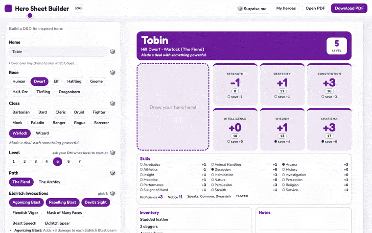

# Hero Sheet Builder

## ▶ Build a hero now → https://ggggggggg.github.io/hero-sheets/

Every fresh visit rolls a brand-new random hero.



[](https://github.com/ggggggggg/hero-sheets/actions/workflows/tests.yml)

A quick, easy character builder that makes 2-page hero sheets kids actually want to use. It
plays up the fun stuff and leaves out the boring details — no spell components, no fiddly rules
footnotes, just a hero your kid can read and play. Pick a race, class and level, roll some dice,
and print.

It's totally open: copy it, change it, host your own — do whatever you like with it.

**Works fully offline.** The whole builder is one self-contained HTML file — save the page and it
keeps working with no internet (only the optional cartoon portraits need to be online). A test
keeps it that way.

**Content packs.** You can add your own races, classes, spells and more as plain JSON packs.
The format is in the [instructions](CUSTOM_CONTENT_GUIDE.md). Drop the JSON into
`examples/`. Want yours available to everyone on the site? Send a pull request and we'll publish
it (packs are contributed under the repo's MIT license — see **License** below).

Three packs are already on the site. Each link opens the builder with that pack loaded:

- [Tobin aka Flame Master](https://ggggggggg.github.io/hero-sheets/?pack=tobin-flame-master)
  adds a Warlock ✦ class, with two pet dragons named Speak and Talk. Tobin is a Mountain
  Dwarf, and that is where his medium armor comes from. Open the link, then press
  “Start as Tobin aka Flame Master”.
- [Turtles & Pirates](https://ggggggggg.github.io/hero-sheets/?pack=turtles-and-pirates)
  adds the Turtle-folk ✦ race, who swim at 30 ft and can pop into their shell (+10 Armor,
  +10 on every save, and everything only does half damage), a Pirate ✦ path for rogues, the
  Bubble Shield spell, a Potion of Bounciness, and an anchor.
- [Mutants & Meltdowns](https://ggggggggg.github.io/hero-sheets/?pack=mutants-and-meltdowns)
  is the world after the Big Oops. It adds Mutant, Beastling, Sprout, Rustbucket, and Pure
  Normal, plus the Scavenger, Esper, and Brute classes. Open the link and try Start as Spanner,
  Fungus, or Grud.

Developer notes are in `CLAUDE.md`.


---

# Developing

The builder is a TypeScript app. `npm run build` writes one self-contained `dist/index.html`.

```bash
npm install
npm run dev
npm test
npm run e2e
npm run build
npm run demo
```

`src/content.json` is the built-in rules (levels 1–7). `src/core.ts` turns a request into a hero and then into sheet HTML. Text uses `{PLACEHOLDERS}`; anything the tables don't fill raises an error. The PDF is drawn in the browser: each page becomes a JPEG and a small hand-written PDF wraps those images. Cartoon portraits come from DiceBear, loaded only when someone asks for one.

Packs live in `examples/*.json`. The format is in the [instructions](CUSTOM_CONTENT_GUIDE.md).

Tests run on GitHub Actions (`.github/workflows/tests.yml`). `npm test` builds every race, class, subclass, and level, and checks that editing a row a hero uses changes the sheet. `npm run e2e` opens the built site and checks that every subclass at level 7 is still exactly two pages.

## License

Everything in this repo — the code and all content, including the packs in `examples/` — is under
one license, the **MIT License** (see `LICENSE`). Send a pack as a pull request and it's contributed
under that same license, so only submit content you can license this way (your own, or open material
like the SRD).

The built-in game content is adapted from the D&D 5.1 SRD, which requires this notice:

> This work includes material taken from the System Reference Document 5.1 ("SRD 5.1") by Wizards
> of the Coast LLC and available at https://dnd.wizards.com/resources/systems-reference-document.
> The SRD 5.1 is licensed under the Creative Commons Attribution 4.0 International License available
> at https://creativecommons.org/licenses/by/4.0/legalcode.
